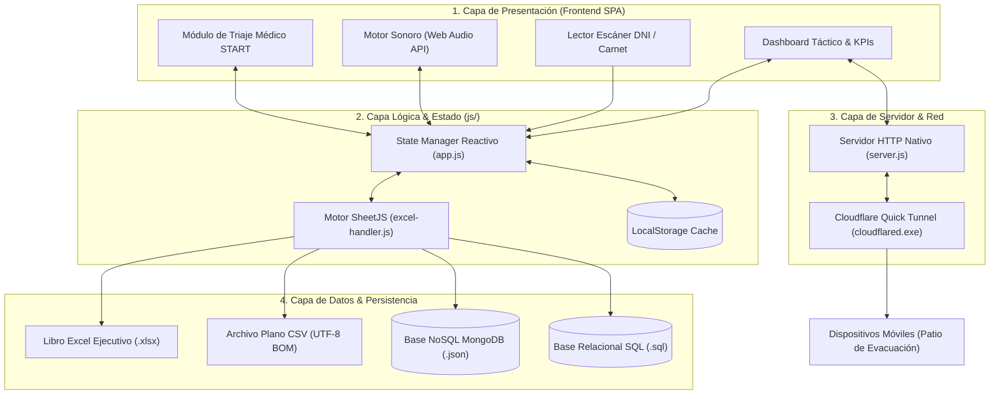

# SIS-TERREMOTO | Sistema de Control de Asistencias y Evacuación de Emergencia

> **Proyecto Académico:** Ingeniería de Software / Informática II  
> **Docente Evaluador:** Prof. Feibert Guzmán  
> **Institución:** Corporación Universitaria Lasallista (Unilasallista)  
> **Versión del Sistema:** v1.5 (Edición Táctica Resiliente Offline)


---

## 📌 1. Nombre
**SIS-TERREMOTO** *(Sistema de Información Sísmica, Pase de Asistencia Táctico y Triaje de Emergencia)*.

---

## 📝 2. Descripción
**SIS-TERREMOTO** es una solución de software táctica de respuesta rápida diseñada para gestionar el **censo, pase de lista en tiempo real, georreferenciación de personas y triaje médico START** de estudiantes, docentes y personal administrativo durante simulacros o situaciones reales de terremoto/sismo.

El sistema está concebido bajo el principio de **resiliencia total offline**: ante el colapso de redes eléctricas, torres celulares o servicio de Internet durante una catástrofe, la plataforma opera de manera 100% autónoma en cualquier dispositivo (computadoras portátiles, tablets o celulares), garantizando que las brigadas y docentes clasifiquen a las personas a salvo, identifiquen a los heridos y entreguen coordenadas exactas de las personas atrapadas a los cuerpos de socorro (Bomberos, Cruz Roja, Defensa Civil).

---

## ⚠️ 3. Problema
Durante un movimiento telúrico en campus universitarios e instituciones educativas se presentan fallas críticas en los protocolos tradicionales de evacuación:
1. **Listas en Papel Ineficientes y Vulnerables:** Las planillas físicas se mojan, se destruyen o se quedan dentro de las aulas colapsadas al momento de evacuar.
2. **Caída de Conectividad e Infraestructura:** Las plataformas web convencionales en la nube quedan inaccesibles cuando fallan los routers, módems o torres de telefonía.
3. **Dispersión de la Población:** Al sonar la alarma, muchos estudiantes no se encuentran en sus aulas de origen (están en cafeterías, laboratorios, baños o pasillos), lo que genera incertidumbre sobre su paradero.
4. **Falta de Triaje Médico Inmediato:** No existe un registro estandarizado que clasifique a los heridos según su gravedad ni que informe al Centro de Operaciones de Emergencia (COE) quiénes requieren rescate urgente.
5. **Retraso en la Consolidación de Reportes:** Consolidar manualmente los datos de decenas de grupos demora horas valiosas para los equipos de rescate.

---

## 🎯 4. Objetivos

### 4.1. Objetivo General
Desarrollar e implementar un sistema de software resiliente, táctico y multiplataforma para el control de asistencias, georreferenciación de ocupantes y triaje de heridos durante evacuaciones por terremoto, asegurando operatividad continua tanto en entornos sin conexión como en redes móviles distribuidas.

### 4.2. Objetivos Específicos
* **Automatizar el pase de lista:** Proveer mecanismos de registro a 1 clic, lectura rápida de códigos DNI y pase masivo de grupos en zonas seguras.
* **Georreferenciar en tiempo real:** Clasificar la ubicación espacial de los estudiantes (*En el Aula Base*, *En Zona Segura*, *En Otra Parte*, *En Tránsito* o *Atrapado*).
* **Integrar Triaje Médico START:** Categorizar a las víctimas según la norma internacional (*Verde/Leve*, *Amarillo/Moderado*, *Rojo/Grave*, *Negro/Fallecido*) con registro de notas clínicas y contactos de emergencia.
* **Garantizar interoperabilidad de datos:** Permitir la carga de nóminas en Excel/CSV y la exportación inmediata hacia MongoDB (NoSQL), motores relacionales (SQL), hojas de cálculo ejecutivas y actas impresas oficiales para el COE.
* **Facilitar despliegue ágil en campo:** Proporcionar ejecución en un solo clic mediante servidor web local y túneles seguros HTTPS para acceso móvil desde teléfonos celulares en los patios de evacuación.

---

## 🛠️ 5. STACK Tecnológico

| Capa | Tecnología | Propósito |
| :--- | :--- | :--- |
| **Frontend UI** | **HTML5 Semántico + Vanilla CSS3** | Interfaz táctica de alto contraste (modo oscuro/claro), layout responsivo (Grid/Flexbox) y reglas de impresión A4 para actas del COE. |
| **Lógica de Cliente** | **JavaScript (ES6+)** | Manejo del estado reactivo global, filtros instantáneos, eventos de escáner y manipulación del DOM sin dependencias pesadas. |
| **Procesamiento de Archivos** | **SheetJS (xlsx.full.min.js)** | Motor en memoria para lectura, validación y generación de archivos Excel (`.xlsx`) y planos (`.csv`). |
| **Síntesis de Audio** | **Web Audio API** | Generador matemático de frecuencias para sirenas sísmicas y tonos de confirmación acústica sin requerir archivos `.mp3` externos. |
| **Servidor Web Local** | **Node.js (Módulos nativos `http`, `fs`, `path`)** | Servidor web ultra ligero de latencia cero, sin `node_modules` externos y bajo consumo de recursos (< 15 MB RAM). |
| **Persistencia Local** | **Web Storage API (LocalStorage)** | Almacenamiento local persistente tolerante a apagones y recargas del navegador. |
| **Bases de Datos** | **MongoDB / PostgreSQL / MySQL / SQLite** | Exportación políglota a esquemas documentales NoSQL (`.json`) y relacionales (`.sql`). |
| **Conectividad Móvil** | **Cloudflare Quick Tunnels (`cloudflared`)** | Enlace inverso cifrado TLS 1.3 para exponer la app a smartphones sin configurar NAT ni IP fija. |

---

## 🏗️ 6. Arquitectura del Sistema

El sistema implementa una **Arquitectura Híbrida Descentralizada (Offline-First / Edge-Ready)** estructurada en cuatro capas:



---

## 💻 7. Instalación

### Requisitos Previos:
* **Node.js** (Versión 14.x o superior instalada).
* Sistema Operativo: **Windows 10/11**, Linux o macOS.
* Navegador Web Moderno (Chrome, Edge, Firefox, Safari o Brave).

### Pasos de Instalación:
1. **Clonar o descargar el repositorio:**
   ```bash
   git clone https://github.com/tu-usuario/sis-terremoto.git
   cd "Ing Software"
   ```
2. **Verificar la integridad de los archivos:**
   Asegúrese de contar con la estructura base:
   - `index.html`
   - `server.js`
   - `css/styles.css`
   - `js/app.js`, `js/excel-handler.js`, `js/sound.js`
   - `cloudflared.exe` (para túneles en Windows)
   - Scripts `.bat` ejecutables.

3. **Sin instalación pesada de dependencias:**
   El proyecto no requiere ejecutar `npm install` para su funcionamiento base ya que utiliza los módulos nativos de Node.js y CDNs empaquetados.

---

## ⚙️ 8. Configuración

El comportamiento del sistema puede parametrizarse fácilmente:

1. **Puerto de Escucha:** Por defecto `3000`. Puede modificarse en `server.js` o mediante variable de entorno:
   ```powershell
   $env:PORT=8080; node server.js
   ```
2. **Docente y Curso por Defecto:** Configurados en `index.html` y `js/app.js` (`Prof. Feibert Guzmán` / `Ing. Informática 2`).
3. **Puntos Seguros Institucionales:** Parametrizados en el selector de zonas:
   - *Plazoleta Central (Punto Seguro Principal)*
   - *Bloque A*, *Bloque B*, *Bloque C*
   - *Administrativo*, *Cafetería*, *Biblioteca*, *Bloque de Veterinaria*.

---

## 🗄️ 9. Base de Datos

El sistema genera estructuras de datos listas para su ingesta directa en bases de datos NoSQL y Relacionales.

### 9.1. Esquema NoSQL (MongoDB)
Al exportar en formato JSON, se descarga un documento con la siguiente estructura:
```json
{
  "_id": "SESION-20260821-104512",
  "metadata": {
    "docente_a_cargo": "Prof. Feibert Guzmán",
    "asignatura": "Ingeniería de Software",
    "aula_origen": "Bloque A - Aula 201",
    "punto_encuentro": "Plazoleta Central",
    "fecha_sesion": "2026-08-21",
    "hora_inicio": "10:44:50",
    "total_censo": 35,
    "total_a_salvo": 33,
    "total_heridos": 1,
    "total_desaparecidos": 1
  },
  "estudiantes": [
    {
      "codigo": "EST-101",
      "dni": "1028491023",
      "nombre": "Valeria Gómez Mendoza",
      "rol": "Estudiante",
      "estado_asistencia": "safe",
      "estado_ubicacion": "safe_zone",
      "ubicacion_detalle": "Plazoleta Central",
      "triage_severidad": "none",
      "hora_registro": "10:45:12",
      "contacto_emergencia": "Carlos Gómez - 3012233445"
    }
  ]
}
```

* **Importación en MongoDB CLI:**
  ```powershell
  mongoimport --db sistemas_evacuacion --collection asistencias_sismo --file "Base_Datos_Sismo.json" --jsonArray
  ```

### 9.2. Esquema Relacional (SQL DDL / DML)
Al pulsar `Descargar SQL`, se genera el script con sintaxis ANSI/PostgreSQL:
```sql
CREATE TABLE IF NOT EXISTS sesion_evacuacion (
    id_sesion VARCHAR(50) PRIMARY KEY,
    docente_cargo VARCHAR(100) NOT NULL,
    curso VARCHAR(100) NOT NULL,
    aula_origen VARCHAR(100),
    punto_encuentro VARCHAR(100),
    fecha_registro DATE,
    total_estudiantes INT,
    total_a_salvo INT,
    total_heridos INT,
    total_desaparecidos INT
);

CREATE TABLE IF NOT EXISTS registro_personas (
    id_registro SERIAL PRIMARY KEY,
    id_sesion VARCHAR(50) REFERENCES sesion_evacuacion(id_sesion),
    codigo VARCHAR(30) NOT NULL,
    dni VARCHAR(20),
    nombre_completo VARCHAR(150) NOT NULL,
    rol VARCHAR(50),
    estado_asistencia VARCHAR(20),
    estado_ubicacion VARCHAR(50),
    triage_severidad VARCHAR(20),
    hora_registro TIME,
    contacto_emergencia VARCHAR(150)
);
```

---

## 📊 10. Configuración del Excel (.xlsx / .csv)

El sistema procesa y valida planillas de censo institucional con las siguientes columnas estándar:

### 10.1. Estructura de Columnas Requeridas:
| Columna | Obligatorio | Descripción | Ejemplo |
| :--- | :---: | :--- | :--- |
| **Código / ID** | Sí | Identificador único del alumno o funcionario | `EST-101` |
| **DNI / Documento** | No | Cédula o documento de identidad para escaneo | `1028491023` |
| **Nombre Completo** | Sí | Nombres y apellidos completos | `Valeria Gómez Mendoza` |
| **Rol** | No | Estudiante, Docente, Brigadista, Administrativo | `Estudiante` |
| **Docente / Profesor** | Sí | Nombre del profesor encargado de la materia | `Prof. Feibert Guzmán` |
| **Carrera / Asignatura** | No | Nombre del curso o programa académico | `Ingeniería de Software` |
| **Aula / Ubicación Base** | Sí | Salón habitual donde se dicta la clase | `Bloque A - Aula 201` |
| **Teléfono** | No | Número de celular del estudiante | `+57 300 654 3210` |
| **Contacto Emergencia** | No | Nombre y número de familiar | `Carlos Gómez - 3012233445` |
| **Condición Médica** | No | Alergias, asma, movilidad reducida, etc. | `Asma` |

### 10.2. Descarga de Plantilla Oficial:
Dentro de la aplicación, haga clic en el botón **`📋 Plantilla`** o **`Descargar Plantilla Excel`** en la ventana de carga para obtener el archivo modelo preconfigurado con fórmulas y estilos.

---

## 👥 11. Usuarios y Datos de Prueba (Simulación)

El sistema incluye datos precargados para realizar simulacros inmediatos:

| ID | Nombre Completo | Rol | Docente a Cargo | Aula Base | Ubicación Actual | Estado Inicial |
| :--- | :--- | :--- | :--- | :--- | :--- | :--- |
| `EST-101` | Valeria Gómez Mendoza | Estudiante | Prof. Feibert Guzmán | Bloque A - Aula 201 | Plazoleta Central | `🟢 A Salvo` |
| `EST-102` | Mateo Sebastián Ríos | Estudiante | Prof. Feibert Guzmán | Bloque A - Aula 201 | Plazoleta Central | `🟢 A Salvo` |
| `EST-103` | Camila Belén Torres | Estudiante | Dra. Carmen Benavides | Bloque Veterinaria | Cafetería Central | `🟡 Herido (Triage)` |
| `EST-104` | Santiago Andrés Cruz | Estudiante | Prof. Feibert Guzmán | Bloque A - Aula 201 | Desconocida | `🔴 Faltante` |
| `DOC-201` | Prof. Feibert Guzmán | Docente | Titular Asignatura | Bloque A - Sala Cómputo| Plazoleta Central | `🟢 A Salvo` |
| `BRIG-01` | Marco Antonio Vargas | Brigadista | Seguridad y Salud | Puesto de Mando (COE) | Plazoleta Central | `🟢 A Salvo` |

---

## 🔌 12. API y Métodos del Sistema

La arquitectura expone métodos internos modulares y un servidor HTTP de recursos estáticos:

### 12.1. Endpoints del Servidor (`server.js`):
* `GET /`: Entrega la interfaz táctica principal (`index.html`).
* `GET /css/styles.css`: Estilos visuales y reglas print.
* `GET /js/*.js`: Módulos de lógica de cliente y SheetJS.
* `GET /assets/*`: Recursos gráficos e insignias institucionales.

### 12.2. API de Métodos Internos (`js/excel-handler.js` & `js/app.js`):
```javascript
// 1. Exportar libro oficial multi-hoja a Excel
ExcelHandler.exportToExcel(rosterData, metadata);

// 2. Exportar base de datos plana CSV (UTF-8 con BOM)
ExcelHandler.exportToCSV(rosterData);

// 3. Exportar base de datos estructurada JSON (MongoDB ready)
ExcelHandler.exportToJSON(rosterData, metadata);

// 4. Exportar script de base de datos relacional SQL
ExcelHandler.exportToSQL(rosterData, metadata);

// 5. Sintetizador de audio acústico (Web Audio API)
window.soundSystem.playSiren();     // Sirena de emergencia de evacuación
window.soundSystem.playSuccess();   // Confirmación acústica de persona a salvo
window.soundSystem.playWarning();   // Tono de atención para heridos / triaje
window.soundSystem.playDanger();    // Alerta crítica de persona no localizada
```

---

## 🧪 13. Pruebas y Casos de Verificación

Se definieron los siguientes casos de prueba para validar la robustez del sistema:

| ID Caso | Descripción del Caso | Procedimiento | Resultado Esperado |
| :--- | :--- | :--- | :--- |
| **CP-01** | **Resiliencia Offline Total** | Desconectar el cable de red / WiFi y recargar la página. | La aplicación sigue operativa con persistencia en LocalStorage sin pérdida de datos. |
| **CP-02** | **Validación de Carga Excel** | Cargar un archivo `.xlsx` sin la columna obligatoria `Código`. | El sistema rechaza el archivo y emite una alerta descriptiva al usuario. |
| **CP-03** | **Escáner Rápido de DNI** | Digitar `1028491023` y presionar `Enter` en el buscador rápido. | El estudiante `Valeria Gómez` se marca automáticamente como `🟢 A Salvo` con su hora actual. |
| **CP-04** | **Triaje Médico START** | Asignar severidad `Rojo (Grave)` a un alumno y guardar. | El contador de heridos se incrementa, la fila se resalta en rojo y se registran las notas de rescate. |
| **CP-05** | **Exportación Multi-Formato** | Pulsar `Finalizar Pase de Lista` y descargar los 4 formatos. | Se generan correctamente los archivos `.xlsx`, `.csv`, `.json` y `.sql`. |

---

## 🚀 14. Despliegue

### Opción A: Despliegue Local Autónomo (Recomendado en Simulacros Offline)
Haga doble clic en el archivo:
```cmd
iniciar_servidor_local.bat
```
El script iniciará el servidor en el puerto 3000 y abrirá automáticamente el navegador en su equipo.

### Opción B: Despliegue Híbrido Móvil con Cloudflare Tunnel
Haga doble clic en el archivo:
```cmd
iniciar_con_tunel_cloudflare.bat
```
El script iniciará el servidor Node.js y creará un túnel público seguro HTTPS gestionado por `cloudflared.exe`.

### Opción C: Despliegue en Servidores Web / Nginx / Docker
Puede servirse como cualquier aplicación estática en Nginx o Apache:
```nginx
server {
    listen 80;
    server_name evacuacion.unilasallista.edu.co;
    root /var/www/sis-terremoto;
    index index.html;
}
```

---

## 🌐 15. URL de Acceso

* **Acceso Local (Mismo Equipo):**  
  👉 [`http://localhost:3000`](http://localhost:3000)

* **Acceso en Red Local LAN (Mismo WiFi / Red de Brigada):**  
  👉 `http://<IP-DE-TU-EQUIPO>:3000` *(Ejemplo: `http://192.168.1.50:3000`)*

* **Acceso Público Móvil Seguro (Túnel Cloudflare para Celulares):**  
  👉 Se genera dinámicamente al ejecutar `iniciar_con_tunel_cloudflare.bat`, por ejemplo:  
  `https://tu-nombre-aleatorio.trycloudflare.com`

---

## 👨‍🏫 Créditos y Autoría
* **Proyecto Académico:** Ingeniería de Software / Informática II
* **Docente Evaluador:** Prof. Feibert Guzmán
* **Institución:** Corporación Universitaria Lasallista
* **Versión:** 1.5 - SIS-TERREMOTO
